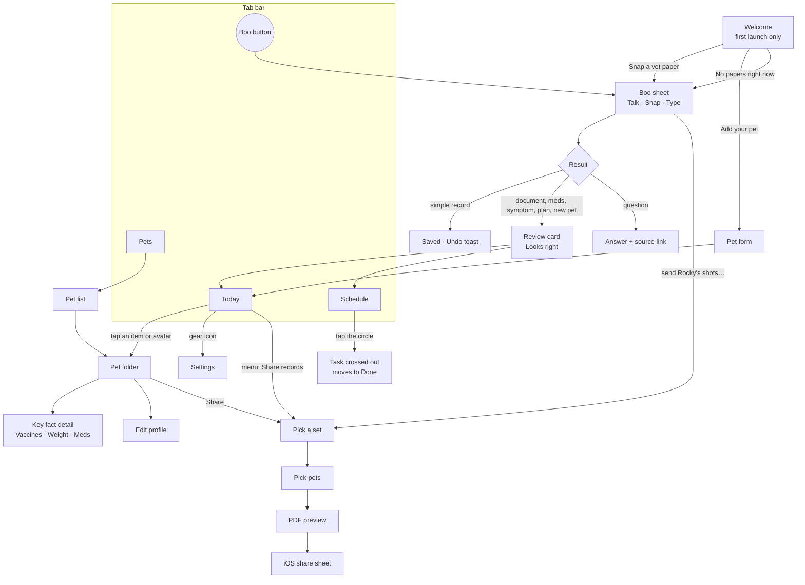

# SmartBoo — Architecture

How the first version is put together: screens and navigation, folders, data, native features, mobile UI rules, and the build schedule. Product decisions live in [PRODUCT.md](PRODUCT.md).

## 1. Screen map and navigation

A floating **tab bar**: a black capsule with three tabs — **Today · Schedule · Pets** — plus the **Boo button** to the right of it. Today and Pets have a **stack** inside (screens open "deeper" with a back arrow at the top left). **Boo is not a screen**: it is a bottom sheet that opens over whatever screen you are on and closes with a swipe down.

**Schedule** is the plan view: a week strip at the top, then *Due today*, *Done today*, *Tomorrow* and *Later this week*. Tapping a task's circle crosses it out and moves it to Done (tap again to undo).



- **Welcome** shows only until the first pet exists.
- **Share** is a 3-step stack: set → pets → PDF preview → iOS share sheet. It opens from the pet folder, from Boo, or from the menu on Today.
- **Settings** is a stack screen opened from the gear icon on Today (vet contacts, notification timing, about).

## 2. Folder structure

```
src/
  screens/      one folder per screen: Welcome, Today, Schedule, PetList, PetFolder, Share, Settings
  components/   reusable UI: buttons, cards, review card, tiles, task row, tab bar, bottom sheet
  styles/       tokens.css from Figma Variables + base styles
  data/         data types, the storage module (store), and sample data (Rocky, Milo, Cleo, Tank)
  lib/          bridges to the phone and the server: boo client, notifications, pdf, camera, speech
functions/
  api/boo       Boo's server function (Cloudflare Pages Functions), deployed with the web version
docs/           PRODUCT.md, ARCHITECTURE.md, screenshots
design/         early HTML sketches (not part of the app)
```

- **screens** — what the user sees as a whole page; screens compose components and read data through `data/store`.
- **components** — the building blocks; no data loading inside, only props. Each one gets a Storybook story.
- **styles** — the only place where colors, spacing, radii and fonts are defined.
- **data** — the shape of the data and the one module that reads and writes it.
- **lib** — everything that talks to native plugins or the network, so screens never call plugins directly.
- **functions** — server code; never imported by the app.

Real vet documents used to test Boo live in a local `boo-tests/` folder that is listed in `.gitignore` and never committed.

## 3. Data

**Until the demo, everything lives on the phone** — no accounts, no sign-in, no database server.

- **Where:** the app's own files via `@capacitor/filesystem` (Data directory): one JSON file with pets, records, vaccines, meds, tasks and reminders, plus original photos and PDFs as separate files.
- **Why files and not browser storage:** inside a Capacitor app, iOS may clear the web view's localStorage/IndexedDB when the device is low on space. The app's own files are not cleared. In the browser (web version, Storybook), the same Filesystem plugin falls back to IndexedDB, so the code is the same.
- **Why not SQLite:** a few hundred records per household don't need a database; a JSON file is simpler to read, debug and migrate.
- **One module:** every read and write goes through `src/data/store`. After the demo, only this module is rewritten to use Supabase (backup, sign-in, household sharing).
- **App state:** a small store (Zustand) on top of `data/store`, so screens update instantly when Boo saves something.
- **Reminders** are scheduled as local notifications from tasks; whenever a task changes, its notifications are rescheduled. Repeats are counted from the actual completion date.

**Boo's server function** (`functions/api/boo`, Cloudflare Pages Functions):

- Receives a photo/PDF or a text phrase plus context (the household's pets, active tasks, current date) and returns strict JSON: records, vaccines, tasks, questions, or an answer.
- The AI key is stored as a Cloudflare secret and never ships in the app.
- Per-device rate limit using an anonymous device ID from `@capacitor/device`; a monthly spending cap set in the AI provider's console.
- Documents and phrases are not stored after parsing. No audio ever leaves the phone — speech is transcribed on the device.
- The AI model is chosen during the Boo spike, after testing on real vet documents.
- An anonymous event counter (no personal data) for the success metric.

## 4. Native features → Capacitor plugins

| Feature | Plugin |
| --- | --- |
| Camera and photo library | `@capacitor/camera` |
| PDF from Files | `@capawesome/capacitor-file-picker` |
| Storing data and documents | `@capacitor/filesystem` |
| Reminders | `@capacitor/local-notifications` |
| Share a PDF | `@capacitor/share` + on-device PDF generation with `jsPDF` |
| Voice (Talk) | `@capgo/capacitor-speech-recognition` — on-device, live partial results |
| Haptics | `@capacitor/haptics` |
| Anonymous ID for rate limiting | `@capacitor/device` |
| Keyboard and status bar | `@capacitor/keyboard`, `@capacitor/status-bar` |
| Call the vet | a plain `tel:` link — no plugin |

All of them support Capacitor 8 and Swift Package Manager (no CocoaPods). `@capacitor-community/speech-recognition` was ruled out: it targets Capacitor 7 and ships only a CocoaPods spec. In the browser, Talk falls back to the Web Speech API where available, otherwise to typing.

## 5. Mobile UI rules

- Works from **360px** wide; designed and checked at **390px**.
- **Safe areas:** `viewport-fit=cover` and `env(safe-area-inset-*)`, so content never sits under the notch or the home indicator.
- **Touch targets** at least **44×44px**.
- **No hover-only states**; pressed states instead.
- **No text selection** on buttons, tabs and cards; no tap highlight.
- **The page never scrolls sideways** as a whole. Rows built to swipe sideways inside a screen are fine — e.g. the filter chips and the Your Pack row.
- Boo's text field stays visible above the keyboard.
- Light and dark themes follow the phone setting.

## 6. What happens when

| When | What |
| --- | --- |
| by Sun Nov 8 | P3: skeleton of all screens with sample data → P4: Capacitor, app in the iPhone simulator → P5: push to GitHub. P6: tokens from Figma (Fri Nov 6) |
| week 2, in parallel | **Boo spike:** server function + 10–15 real vet documents; choose the AI model; measure speed and accuracy |
| Wed Nov 11 | Components on tokens: review card, key-fact tile, task row, bottom sheet, tab bar — with pressed, disabled and loading states |
| Fri Nov 13 | Storybook: every component in every state, iPhone size, light and dark; published link |
| Wed Nov 18 | Feature in a branch + PR: **Snap a vet paper → Boo → reminders** (camera + local notifications) |
| Fri Nov 20 | PR review and merge; then Talk and Share |
| Wed Nov 25 | Release: icon, splash, signing, TestFlight; web version on Cloudflare Pages |
| Fri Nov 27 | Claude Skill and portfolio case |
| Wed Dec 2 | Demo day |

Boo is not covered by the course sessions, so its spike runs alongside week 2; otherwise there would be nothing to connect on Nov 18.
